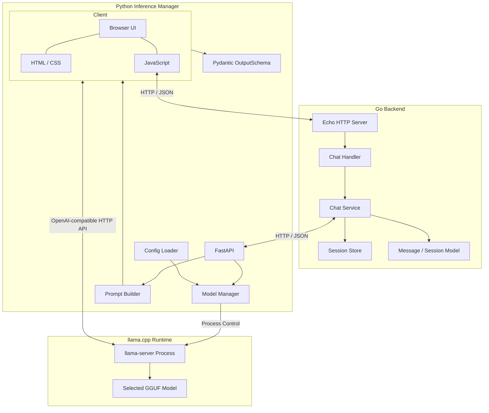
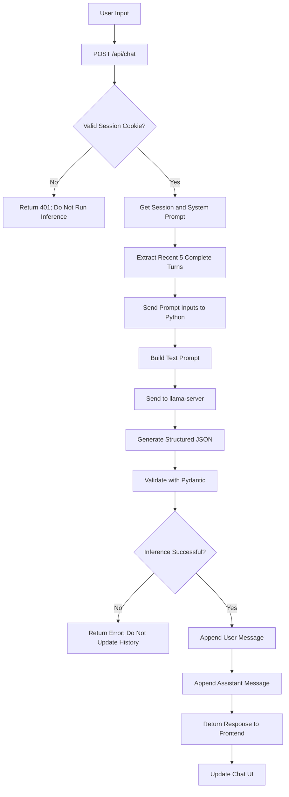
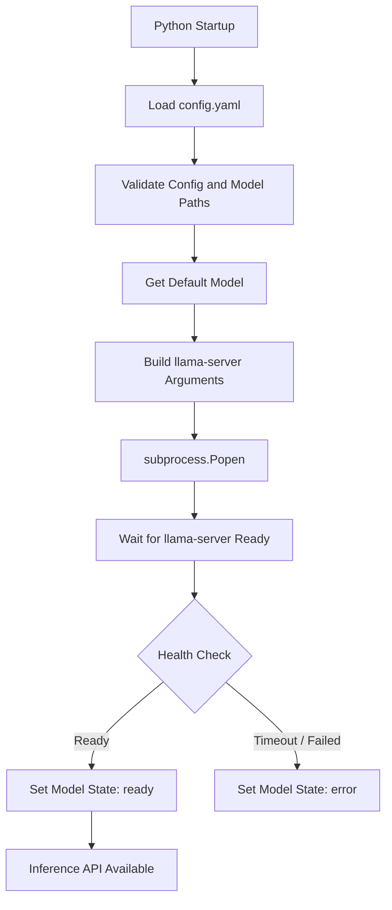

# Local LLM Chat Application 仕様書

**Version:** 1.2  
**Status:** Draft  
**更新内容:** 使用モデルの実行中切り替えを除外し、`config.yaml` のdefaultモデルを起動時にロードする。

---

# 1. 概要

## 1.1 目的

Go + EchoとPythonを使用して、ローカルLLMとブラウザ上で会話できるシンプルなチャットアプリケーションを開発する。

LM Studioの簡易版を想定し、以下の機能を提供する。

- ブラウザ上でのチャット
- UIからのSystem Prompt設定
- `config.yaml`で指定したモデルとのチャット
- 会話履歴のメモリ管理
- 直近5ターンの会話履歴をLLMに入力
- Pythonによるllama-serverの起動・停止・管理
- llama-serverを介したLLM推論
- JSON Schemaによる出力形式の制約
- セッション単位での会話管理

## 1.2 基本方針

- バックエンドはGo + Echoで実装する。
- PythonはInference APIとllama-serverのプロセス管理を担当する。
- LLMの実際の推論はllama.cppの`llama-server`で実行する。
- llama-serverとの通信にはOpenAI互換APIを使用する。
- フロントエンドはHTML / CSS / Vanilla JavaScriptで実装する。
- データベースは使用せず、Goのメモリ上でセッションと会話履歴を管理する。
- 会話履歴はセッションが有効な間だけ保持する。
- LLMへの入力はSystem Prompt、会話履歴、現在のユーザー入力を結合したテキスト形式とする。
- LLMの出力はJSON Schemaに準拠した形式とする。
- モデルや実行ファイルのパスなど、実行環境に依存する設定はルートの`config.yaml`に集約する。
- 初期バージョンではllama-serverを1プロセスだけ起動し、同時にロードするモデルは1つとする。

---

# 2. システム構成

## 2.1 使用技術

| コンポーネント | 技術 | 役割 |
|---|---|---|
| Frontend | HTML | UI構造 |
| Frontend | CSS | UIデザイン |
| Frontend | JavaScript | UI制御・API通信 |
| Backend | Go | アプリケーション本体 |
| Backend Framework | Echo v5 | HTTP API |
| Inference Manager | Python | 推論API、モデルプロセス管理 |
| Inference Framework | FastAPI | Python側HTTP API |
| LLM Runtime | llama.cpp `llama-server` | GGUFモデルのロード・推論 |
| Inter-process Communication | HTTP / OpenAI-compatible API | Pythonからllama-serverへの通信 |
| Process Management | Python `subprocess` | llama-serverの起動・停止 |
| Configuration | YAML | パス、ポート、モデル定義 |
| Data Storage | Go In-Memory | Session / History管理 |
| Data Validation | Pydantic | JSON Schema定義・出力検証 |

## 2.2 システム構成図



## 2.3 各コンポーネントの責務

### Frontend

ブラウザ上でチャット操作を提供する。

- メッセージ入力・送信
- 会話履歴表示
- System Prompt編集
- 現在のモデル・推論サーバー状態の表示
- 会話履歴リセット
- APIレスポンスの表示
- ローディング表示・エラー表示

### Go Backend

アプリケーション全体のチャット管理を担当する。

- HTTP APIの提供
- セッション管理
- 会話履歴管理
- System Prompt管理
- Python Inference Managerへのリクエスト
- LLMレスポンスの取得と返却
- 同一セッションからの同時送信制御

### Python Inference Manager

LLM推論環境とモデルプロセスの管理を担当する。

- `config.yaml`の読み込み
- Goからの推論リクエスト受付
- プロンプト生成
- 会話履歴のテキスト変換
- llama-serverの起動・停止
- llama-serverの起動完了確認
- llama-serverへの推論リクエスト
- JSON Schemaによる出力制約の指定
- 出力JSONのPydantic検証
- プロセス異常終了の検知・状態管理

### llama-server

実際のLLM推論を担当する。

- 指定されたGGUFモデルのロード
- プロンプトの受け取り
- テキスト生成
- JSON Schemaに基づくStructured Output（対応するビルド・APIの場合）

---

# 3. ディレクトリ構成

```text
chat-app/
│
├── config.yaml
│
├── backend/
│   ├── main.go
│   │
│   ├── config/
│   │   └── config.go
│   │
│   ├── handler/
│   │   ├── chat.go
│   │   └── model.go
│   │
│   ├── service/
│   │   ├── chat.go
│   │   └── inference_client.go
│   │
│   ├── store/
│   │   └── session.go
│   │
│   └── model/
│       ├── message.go
│       └── session.go
│
├── inference/
│   ├── main.py
│   ├── config.py
│   ├── server.py
│   ├── prompt.py
│   ├── schema.py
│   └── requirements.txt
│
└── frontend/
    ├── index.html
    ├── style.css
    └── app.js
```

## 3.1 Go Backend

| ファイル | 責務 |
|---|---|
| main.go | Echo起動、ルーティング登録 |
| config.go | Go側の設定読み込み（必要な場合） |
| chat.go (handler) | チャットHTTPリクエスト・レスポンス処理 |
| model.go (handler) | モデル一覧・状態取得API |
| chat.go (service) | チャット処理の制御 |
| inference_client.go | Python APIとのHTTP通信 |
| session.go (store) | セッションの保存・取得・削除 |
| message.go | Message構造体 |
| session.go (model) | Session構造体 |

## 3.2 Python Inference Manager

| ファイル | 責務 |
|---|---|
| main.py | FastAPI起動、API定義、ライフサイクル管理 |
| config.py | `config.yaml`読み込み・設定検証 |
| server.py | llama-serverの起動・停止、HTTP通信、出力検証 |
| prompt.py | プロンプト生成 |
| schema.py | Pydantic出力スキーマ |
| requirements.txt | Python依存パッケージ |

## 3.3 Frontend

| ファイル | 責務 |
|---|---|
| index.html | チャット画面の構造 |
| style.css | UIデザイン |
| app.js | API通信・画面更新 |

---

# 4. 設定ファイル仕様

## 4.1 config.yaml

アプリケーションの実行環境に依存する設定をルートの`config.yaml`に集約する。

モデルは任意のIDで複数登録できる。UIやAPIではモデルIDを指定し、実際の表示名・モデルパス・起動オプションは設定ファイルから取得する。

```yaml
server:
  host: "127.0.0.1"
  port: 8001

llama_server:
  executable: "C:/llama.cpp/llama-server.exe"
  host: "127.0.0.1"
  port: 8080
  startup_timeout: 120
  shutdown_timeout: 10
  extra_args: ["--jinja"]

models:
  default: "gemma"

  available:
    gemma:
      name: "Gemma"
      path: "D:/Models/gemma.gguf"
      context_size: 8192
      gpu_layers: 99

    qwen:
      name: "Qwen"
      path: "D:/Models/qwen.gguf"
      context_size: 8192
      gpu_layers: 99
```

### 設定項目

| 項目 | 説明 |
|---|---|
| server.host | Python FastAPIのバインドアドレス |
| server.port | Python FastAPIのポート |
| llama_server.executable | llama-server実行ファイルのパス |
| llama_server.host | llama-serverのバインドアドレス |
| llama_server.port | llama-serverのポート |
| llama_server.startup_timeout | 起動完了を待つ最大秒数 |
| llama_server.shutdown_timeout | 停止完了を待つ最大秒数 |
| llama_server.extra_args | 追加の起動引数リスト（省略可） |
| models.default | 起動時にロードするモデルID |
| models.available | 利用可能なモデル定義 |
| models.available.*.name | UI表示用のモデル名 |
| models.available.*.path | GGUFファイルのパス |
| models.available.*.context_size | コンテキスト長 |
| models.available.*.gpu_layers | GPUにオフロードするレイヤー数（整数または `"all"`） |

`models.available`のキー（例：`gemma`、`qwen`）をモデルIDとして扱う。

使用モデルは `models.default` で指定する。モデルを変更する場合は `config.yaml` を編集し、Python Inference APIを再起動する。実行中のモデル切り替えAPIは提供しない。

## 4.2 設定読み込み・検証

- Python起動時に`config.yaml`を読み込む。
- 必須項目が不足している場合は起動エラーとする。
- `executable`の存在を確認する。
- 登録モデルの`path`の存在を確認する。
- `models.default`が`models.available`に存在することを確認する。
- ポート番号やタイムアウト値などの範囲を検証する。
- 設定ファイルのパスは、原則としてアプリケーションのルートを基準に解決する。絶対パスはそのまま使用する。

## 4.3 llama-server起動引数

モデル設定から起動引数を組み立てる。

例：

```powershell
llama-server.exe `
  -m "D:/Models/gemma.gguf" `
  --host 127.0.0.1 `
  --port 8080 `
  --ctx-size 8192 `
  --gpu-layers 99
```

Pythonからは`subprocess.Popen`に引数リストを渡して起動する。シェル文字列として組み立てて実行しない。

```python
args = [
    config.executable,
    "-m", model.path,
    "--host", config.host,
    "--port", str(config.port),
    "--ctx-size", str(model.context_size),
    "--gpu-layers", str(model.gpu_layers),
    *config.extra_args,
]
```

`extra_args`も個別の引数要素として渡す。シェルコマンド文字列には結合しない。

実際に利用するllama.cppのビルドで、指定したオプションがサポートされていることを確認する。

---

# 5. データ設計

## 5.1 Message

会話履歴を構成するメッセージ。

```go
type Message struct {
    Role    string `json:"role"`
    Content string `json:"content"`
}
```

Roleは以下を使用する。

| Role | 説明 |
|---|---|
| user | ユーザーの発言 |
| assistant | LLMの回答 |

## 5.2 Session

会話セッションを管理する構造体。

```go
type Session struct {
    ID           string
    SystemPrompt string
    History      []Message
}
```

Sessionごとに以下の情報を保持する。

- Session ID
- System Prompt
- Conversation History

## 5.3 Session Store

全セッションをメモリ上で管理する。

```go
type SessionStore struct {
    Sessions map[string]*Session
    Mutex    sync.RWMutex
}
```

セッションの取得・更新・削除時にはMutexを使用する。LLM推論中にStore全体のMutexを保持し続けないこと。同一セッションの同時送信は、セッション単位のロックなどで制御する。

## 5.4 セッション管理方式

- セッションIDはUUIDなどで生成する。
- UI初回読み込み時にFrontendが `POST /api/session` を呼び出し、Go Backendがセッションを発行する。
- セッションIDはHttpOnly Cookieだけに設定し、APIレスポンス本文には含めない。
- Cookieはブラウザセッション中のみ有効とし、`HttpOnly`、`SameSite=Lax`、`Path=/` を設定する。HTTPSでは `Secure` も設定する。
- サーバー側のセッションは30分間アクセスがないと期限切れとする。有効なセッションへのアクセス時に期限を延長する。
- `POST /api/session` は有効なCookieがあれば既存セッションを再利用し、Cookieがない・無効・期限切れの場合は新しいセッションを発行してCookieを設定する。
- チャット等の状態を扱うAPIはCookie内のIDがSession Storeに存在することを確認する。Cookieがない、またはセッションが無効・期限切れの場合は `401 Unauthorized` を返し、そのリクエスト内で暗黙に新規セッションを作成しない。
- セッションIDをURLパス、クエリ、リクエスト本文で受け付けない。既存のAPI URLにはセッションIDを含めない。
- Go側はセッションIDをキーとしてSessionを管理する。
- セッションが期限切れになった場合はSession Storeから削除する。
- サーバー再起動時には全セッションが消失する。

---

# 6. チャット処理仕様

## 6.1 基本処理フロー



## 6.2 会話履歴の管理

会話履歴はGo側のSession Storeで保持する。

LLMに入力する際には、直近5ターンのみを使用する。

**1ターン = Userの発言 + Assistantの回答**

そのため、LLMに渡す会話履歴は最大10メッセージとなる。

```text
History:
  Turn 1:
    user: こんにちは
    assistant: こんにちは！

  Turn 2:
    user: Goについて教えて
    assistant: Goはプログラミング言語です。

  Turn 3:
    user: Echoとは？
    assistant: GoのWebフレームワークです。
```

保存する履歴とLLMに渡す履歴は分離する。

- 保存する履歴：セッション内の全履歴
- LLMに渡す履歴：直近5ターンの完了済みの会話
- 現在送信中のユーザー入力：Historyとは別にPythonへ渡す
- 推論成功後：UserとAssistantのメッセージをHistoryに追加する
- 推論失敗時：Historyは更新しない

## 6.3 プロンプト生成

Python側でLLMに渡すプロンプトを生成する。

### プロンプト形式

```text
{system_prompt}

あなたは以下の会話履歴を参考にして、
文脈を維持した回答をしてください。

## 会話履歴

[User]
{previous_user_input}

[Assistant]
{previous_assistant_response}

...

## ユーザーの入力

{user_input}
```

### プロンプト構成要素

| 要素 | 内容 |
|---|---|
| System Prompt | UIから設定されたシステムプロンプト |
| History Instruction | 会話履歴を参考に回答する指示 |
| Conversation History | 直近5ターンの会話 |
| User Input | 現在のユーザー入力 |

会話履歴が存在しない場合は、History部分を省略する。

---

# 7. LLM Inference仕様

## 7.1 Python Inference API

Go BackendからPython Inference ManagerへHTTPリクエストを送信する。

### POST /generate

Request:

```json
{
  "system_prompt": "あなたは親しみやすいAIアシスタントです。",
  "history": [
    {
      "role": "user",
      "content": "こんにちは"
    },
    {
      "role": "assistant",
      "content": "こんにちは！"
    }
  ],
  "user_input": "元気？"
}
```

Response:

```json
{
  "text": "元気だよ！今日はどうしたの？"
}
```

Python側でPrompt Builderを実行し、完成したプロンプトをllama-serverに渡す。

## 7.2 llama-serverとの通信

llama-serverのOpenAI互換Chat Completions APIを使用する。

### Endpoint

```text
POST http://{llama_server.host}:{llama_server.port}/v1/chat/completions
```

Python側で構築したプロンプト全体を、1つのuserメッセージとして送信する。

概念上のリクエスト例：

```json
{
  "messages": [
    {
      "role": "user",
      "content": "{Python側で構築したプロンプト}"
    }
  ],
  "response_format": {
    "type": "json_schema",
    "json_schema": {
      "name": "output",
      "strict": true,
      "schema": {
        "type": "object",
        "properties": {
          "text": {
            "type": "string"
          }
        },
        "required": ["text"],
        "additionalProperties": false
      }
    }
  }
}
```

実際のリクエスト形式は利用するllama.cppのバージョン・API仕様に合わせる。`response_format`によるJSON Schema指定が利用環境でサポートされることを確認する。

## 7.3 Output Schema

Pydanticを使用してLLMの出力形式を定義する。

```python
from pydantic import BaseModel, Field, ConfigDict

class OutputSchema(BaseModel):
    model_config = ConfigDict(extra="forbid")

    text: str = Field(
        description="Assistant response text"
    )
```

### JSON Schema

```json
{
  "type": "object",
  "properties": {
    "text": {
      "type": "string",
      "description": "Assistant response text"
    }
  },
  "required": ["text"],
  "additionalProperties": false
}
```

### 出力例

```json
{
  "text": "こんにちは！今日はどうしたの？"
}
```

LLMの生成時には、llama-serverが対応していればJSON SchemaによるStructured Outputを利用する。

Pydanticは生成結果の検証にも使用する。Pydanticによる検証だけではJSON出力を強制できないため、推論エンジン側の制約機能を利用する。

---

# 8. モデル管理仕様

## 8.1 基本方針

- モデル定義は`config.yaml`の`models.available`に記述する。
- モデルIDは設定ファイル内のキーを使用する。
- Pythonがllama-serverプロセスを管理する。
- 初期バージョンではllama-serverは1プロセスのみ起動する。
- 同時にロードするモデルは1つとする。
- 起動時には`models.default`で指定されたモデルをロードする。
- 使用モデルは起動時に `models.default` から選び、設定変更後の再起動で反映する。

## 8.2 モデル管理状態

Python側で少なくとも以下の状態を管理する。

| 状態 | 説明 |
|---|---|
| stopped | llama-server停止中 |
| starting | 起動処理中 |
| ready | 推論受付可能 |
| stopping | 停止処理中 |
| error | 起動・停止・プロセス異常などのエラー |

現在のモデルIDとプロセス状態はPython側で一元管理する。

## 8.3 起動フロー



起動完了は、プロセスの生成だけでは判定しない。llama-serverのヘルスチェック用エンドポイント等をポーリングし、推論リクエストを受け付けられる状態になったことを確認する。利用するllama.cppビルドのヘルスチェック仕様に合わせる。

## 8.4 プロセス停止・終了処理

- Python終了時には管理中のllama-serverを停止する。
- 停止要求後、設定された`shutdown_timeout`の範囲で終了を待つ。
- タイムアウトした場合はプロセスを強制終了する。
- 起動時にプロセスが異常終了していないかを確認する。
- stdout / stderrは破棄する。起動確認はhealthエンドポイントで行う。
- プロセス管理はPIDだけに依存せず、`Popen`が返すProcessオブジェクトを保持して行う。

---

# 9. API仕様

## 9.1 Go Backend API

| Method | Endpoint | 説明 |
|---|---|---|
| POST | `/api/session` | セッションの発行または再利用 |
| GET | `/api/history` | 会話履歴取得 |
| POST | `/api/chat` | メッセージ送信 |
| POST | `/api/reset` | 会話履歴リセット |
| PUT | `/api/system-prompt` | System Prompt更新 |
| GET | `/api/models/current` | 現在のモデル・状態取得 |

### POST /api/session

FrontendはUI初回読み込み時にこのAPIを呼び出す。Cookieが有効なSession Store上のセッションを指していれば再利用し、Cookieがない・無効・期限切れの場合は新しいセッションを作成する。

- 既存セッションを再利用した場合は `200 OK` を返す。
- 新しいセッションを作成した場合は `201 Created` を返し、`Set-Cookie` で `session_id` を設定する。
- Cookieには `HttpOnly`、`SameSite=Lax`、`Path=/` を設定する。HTTPSでは `Secure` を設定する。ブラウザーセッションCookieとし、`Max-Age` / `Expires` は設定しない。
- Session IDはレスポンス本文に含めない。

Response:

```json
{
  "success": true
}
```

`/api/session` 以外の `/api` エンドポイントは、有効な `session_id` Cookieを必須とする。Cookieがない、またはSession Storeに該当セッションがない場合は `401 Unauthorized` を返し、そのリクエストでは新しいセッションを作成しない。Session IDはURLパス、クエリ、リクエスト本文から受け付けない。

チャット入力が空または不正な場合は400、Python APIの接続失敗や不正応答は502、Python APIがモデル未起動を返した場合は503、Python APIへの接続がタイムアウトした場合は504を返す。

### POST /api/chat

Request:

```json
{
  "message": "こんにちは"
}
```

Response:

```json
{
  "response": "こんにちは！"
}
```

セッションは有効な `session_id` Cookieから特定する。Cookieが無効・期限切れの場合は `401 Unauthorized` を返し、推論を実行しない。

### GET /api/history

Response:

```json
{
  "history": [
    {
      "role": "user",
      "content": "こんにちは"
    },
    {
      "role": "assistant",
      "content": "こんにちは！"
    }
  ]
}
```

### POST /api/reset

会話履歴を初期化する。System Promptは保持する。

Response:

```json
{
  "success": true
}
```

### PUT /api/system-prompt

Request:

```json
{
  "system_prompt": "あなたは親しみやすいAIです。"
}
```

Response:

```json
{
  "success": true
}
```

### GET /api/models/current

Response:

```json
{
  "model_id": "gemma",
  "name": "Gemma",
  "status": "ready"
}
```

## 9.2 Python Inference API

| Method | Endpoint | 説明 |
|---|---|---|
| GET | `/health` | Python API・モデル状態確認 |
| GET | `/models/current` | 現在のモデル・状態取得 |
| POST | `/generate` | LLM推論 |

`GET /health` はPython APIの状態とモデル状態を返す。

```json
{
  "status": "ok",
  "model_status": "ready"
}
```

`GET /models/current` は設定されたモデルID、表示名、状態を返す。

```json
{
  "model_id": "gemma",
  "name": "Gemma",
  "status": "ready"
}
```

`POST /generate` は7.1のリクエストを受け取り、プロンプト生成、llama-server推論、出力検証を行って `{"text":"..."}` を返す。必須項目や型が不正な場合は422、モデルが推論可能でない場合は503、llama-server通信または生成結果の検証に失敗した場合は502を返す。

Go BackendはPython APIを呼び出し、フロントエンドにはGo Backend経由で情報を返す。

Go BackendからPython APIへの接続先は環境変数 `INFERENCE_API_URL` で変更できる。未設定時は `http://127.0.0.1:8001` を使用し、HTTPリクエストのタイムアウトは90秒とする。

---

# 10. Frontend仕様

## 10.1 UI構成

チャット画面はLM Studioの簡易版をイメージする。
FrontendはGo Backendから同一オリジンで配信し、ブラウザーではGoの待受アドレスの `/` を開く。

### 画面要素

1. 現在のモデル・推論状態表示
2. System Prompt設定エリア
3. Chat History表示エリア
4. Message Input
5. Send Button
6. Reset Button

### UIイメージ

```text
+------------------------------------------------+
| Local LLM Chat                                 |
+------------------------------------------------+
| Model: Gemma                                   |
| Status: Ready                                  |
|                                                |
| System Prompt                                  |
| +--------------------------------------------+ |
| | あなたは親しみやすいAIです。               | |
| +--------------------------------------------+ |
|                                                |
| +--------------------------------------------+ |
| | User: こんにちは                           | |
| |                                            | |
| | Assistant: こんにちは！                    | |
| +--------------------------------------------+ |
|                                                |
| +--------------------------------------------+ |
| | メッセージを入力...                        | |
| +--------------------------------------------+ |
|                                   [Send]       |
|                                   [Reset]      |
+------------------------------------------------+
```

## 10.2 JavaScriptの責務

- UI初回読み込み時に `POST /api/session` を呼び出し、成功するまでチャット操作を有効にしない
- 入力フォームの値取得
- Go APIへのHTTPリクエスト
- JSONレスポンスの解析
- チャット履歴の画面表示
- System Promptの更新
- 現在のモデル・状態の表示
- Enterキーによる送信
- ローディング状態の管理
- APIエラーの表示

---

# 11. エラーハンドリング

| 発生箇所 | エラー | 対応 |
|---|---|---|
| Go | Cookieなし・Session Not Found・Session期限切れ | セッションを扱うAPIはHTTP 401を返す。Frontendが `POST /api/session` を呼び出してから再試行する |
| Go | Invalid Request | HTTP 400 |
| Go | Python Connection Error | HTTP 502 |
| Python | llama-server Startup Error | エラー状態を設定して返却 |
| Python | llama-server Not Ready | 推論受付を拒否 |
| Python | llama-server Process Exited | 状態をerrorに更新 |
| Python | LLM Inference Error | HTTP 500 |
| Python | Invalid JSON Output | 再生成またはエラー返却 |
| Frontend | API Error | エラーメッセージ表示 |

LLMの推論に失敗した場合、User MessageをHistoryに追加しない。

llama-serverがreadyでない状態ではチャット送信を拒否し、UIにエラーを表示する。

---

# 12. 非機能要件

## 12.1 データ保持

- データベースは使用しない。
- セッション情報はGoのメモリ上で保持する。
- サーバー再起動時には全セッションが消失する。
- セッションには有効期限を設定する。
- モデル定義は`config.yaml`で管理する。

## 12.2 並行処理

- Session StoreへのアクセスにはMutexを使用する。
- 同一セッションからの同時送信は初期バージョンでは制限する。
- PythonへのHTTPリクエストにはタイムアウトを設定する。
- llama-serverの起動・停止処理は同時に複数実行しない。

## 12.3 セキュリティ

- Session IDは推測困難なランダム値とする。
- セッションIDはサーバーが発行し、HttpOnly Cookieだけで受け渡す。URLやリクエスト本文・クエリで受け付けない。
- セッションを扱うAPIは、CookieのIDがSession Storeに存在することを確認する。
- CookieはHttpOnlyを設定する。
- ブラウザからのAPIアクセスは同一オリジンを基本とする。
- System Promptや会話内容をHTMLに表示する際は適切にエスケープする。
- Python Inference APIとllama-serverは原則としてlocalhostにバインドする。
- 外部ネットワークへInference APIやllama-serverを公開しない。
- プロセス起動時にシェル文字列を使用せず、引数リストを使用する。

---

# 13. 開発ステップ

| Step | 実装内容 |
|---|---|
| 1 | Go + Echoの初期構築 |
| 2 | Message / Session構造体の作成 |
| 3 | Session Storeの実装 |
| 4 | Chat APIの実装 |
| 5 | History管理と直近5ターン抽出 |
| 6 | `config.yaml`の作成・Pythonからの読み込み |
| 7 | Python FastAPIの構築 |
| 8 | llama-serverの起動・停止管理 |
| 9 | 起動状態確認・ヘルスチェック |
| 10 | Prompt Builderの実装 |
| 11 | llama-serverとのHTTP接続 |
| 12 | Pydantic OutputSchema・Structured Output |
| 13 | GoとPythonの接続 |
| 14 | HTML / CSS / JavaScriptによるUI構築 |
| 15 | 全体結合テスト |

---

# 14. 初期バージョンの実装範囲

初期バージョンでは、以下の機能を実装する。

**実装する機能**

- 1つのチャット画面
- セッション管理
- System Prompt編集
- 会話履歴のメモリ保存
- 直近5ターンの履歴をプロンプトに含める
- Python FastAPIによるInference API
- Pythonによるllama-serverの起動・停止
- `config.yaml`でのdefaultモデル指定（変更後はPythonを再起動）
- llama-server経由でのLLM推論
- JSON Schemaによるテキスト出力
- 会話履歴のリセット
- 推論サーバーの状態表示

**初期バージョンでは実装しない機能**

- ユーザー認証
- データベース
- 複数モデルの同時ロード
- ストリーミング生成
- Temperatureなどの生成パラメータUI設定
- 会話履歴の永続化
- 複数チャットルーム
- ファイルアップロード
- UIからのモデル選択・モデル定義変更

---

# 15. 今後の拡張候補

初期バージョン完成後、必要に応じて以下を追加する。

- Temperature / Top-P / Max Tokensの設定
- Streaming Response
- Markdown表示
- コードブロック表示
- 複数セッションの管理
- 会話履歴のエクスポート
- System Promptのプリセット保存
- 推論パラメータのプリセット保存
- モデル定義のUIからの追加・編集
- llama-serverの追加起動オプション設定
- モデルごとの生成パラメータ設定

---

# 16. 実装上の注意事項・未確定事項

- llama.cppのバージョンによってCLIオプション、ヘルスチェック方法、Structured Outputのリクエスト形式が異なる可能性がある。実装時に利用するビルドの仕様を確認する。
- `llama-server`の起動完了は、プロセス生成だけでなくHTTPヘルスチェックで判断する。
- 使用モデルは起動時に `config.yaml` のdefault設定から決定し、変更後はPythonを再起動する。
- 5ターンの履歴は完了済みのUser / Assistantペアを単位として抽出する。
- セッションCookieの期限とサーバー側Sessionの有効期限は整合させる。
